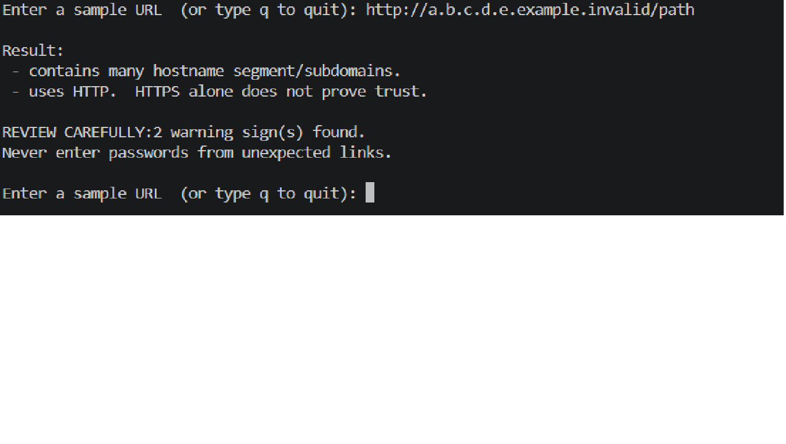
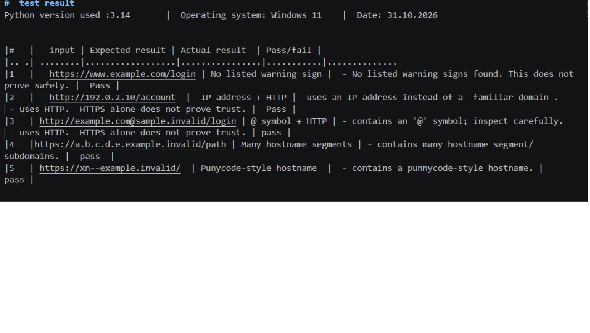

## EWB Phishing URL Awareness Checker

## Overview
[Phishing is a trick that uses fake links or messages to steal your information. 
 Here is what your tool does
 -Reads URL text only: It asks the user to type a URL as text and inspects it for visible warning signs.
 - Checks for warning signs: It flags six specific risks: an @ symbol, an unusually long URL (over 100 characters), an IP-address hostname, 5 or more hostname segments/subdomains, a punycode-style hostname (xn--), and the unencrypted HTTP scheme.
 -Runs interactively: With our added improvements, it runs in a continuous loop so you can test multiple URLs in one session without restarting, and gives a clear "REVIEW CAREFULLY" summary count when threats are detected.
 

 What your tool does NOT do:
It never opens websites, visits links, scans for malware, or proves that a URL is safe. It is strictly an educational tool to help you learn about basic phishing risks.]

  
## Features
- Detects an @ symbol in the URL
- Flags unusually long URLs (over 100 characters)
- Flags IP-address hostnames
- Flags many hostname segments (5 or more)
- Flags punycode-style hostnames (xn--)
- Flags the HTTP scheme
- Interactive while loop to check multiple URLs without restarting
- Review summary count when warning signs are found

## Requirements
Python 3.10 or later. No extra packages.

## How to Run
Windows:
python phishing_checker.py

Mac/Linux:
python3 phishing_checker.py

## Example Output
[Enter a sample URL  (or type q to quit): http:example.com@sample.invalid/login

Result:
 - contains an '@' symbol; inspect carefully.
 - uses HTTP.  HTTPS alone does not prove trust.

REVIEW CAREFULLY:2 warning sign(s) found.
Never enter passwords from unexpected links.

Enter a sample URL  (or type q to quit):
]

## Testing
 Python version used :3.14       |  Operating system: Windows 11    |  Date: 1.11.2026

|#   |   input | Expected result | Actual result  | Pass/fail |
|.. .| ........|..................|................|...........|..............
|1   |   https://www.example.com/login | No listed warning sign |  - No listed warning signs found. This does not prove safety. |  Pass |       
|2   |   http://192.0.2.10/account  |  IP address + HTTP |  uses an IP address instead of a  familiar domain .
 - uses HTTP.  HTTPS alone does not prove trust. |  Pass |
|3   | http://example.com@sample.invalid/login | @ symbol + HTTP | - contains an '@' symbol; inspect carefully.
 - uses HTTP.  HTTPS alone does not prove trust. | pass |
|4   |https://a.b.c.d.e.example.invalid/path | Many hostname segments | - contains many hostname segment/subdomains. |  pass  |
|5   | https://xn--example.invalid/  | Punycode-style hostname  |  - contains a punnycode-style hostname. |  pass |

## Screenshots

## Improvements
1. **Interactive Loop:** Added a `while True` loop so the user can test multiple URLs in a single session and type 'q' to quit. Tested by running continuous inputs and exiting successfully.
2. **Review Summary:** Added a helper function to count and display a clear "REVIEW CAREFULLY" warning count when active threats are detected. Tested using sample IPs and modified inputs.

## Limitations
This is an educational tool. It only reads URL text. It does not visit URLs, scan for malware or prove that a URL is safe. No warning signs found does NOT mean a URL is safe.

## Ethical Use
Use sample strings only. Do not collect credentials. Do not use this project to deceive anyone or to test websites without permission.

## Author
SAURAV THAKUR,Cyber security batch 1( EWB Courses"). 
